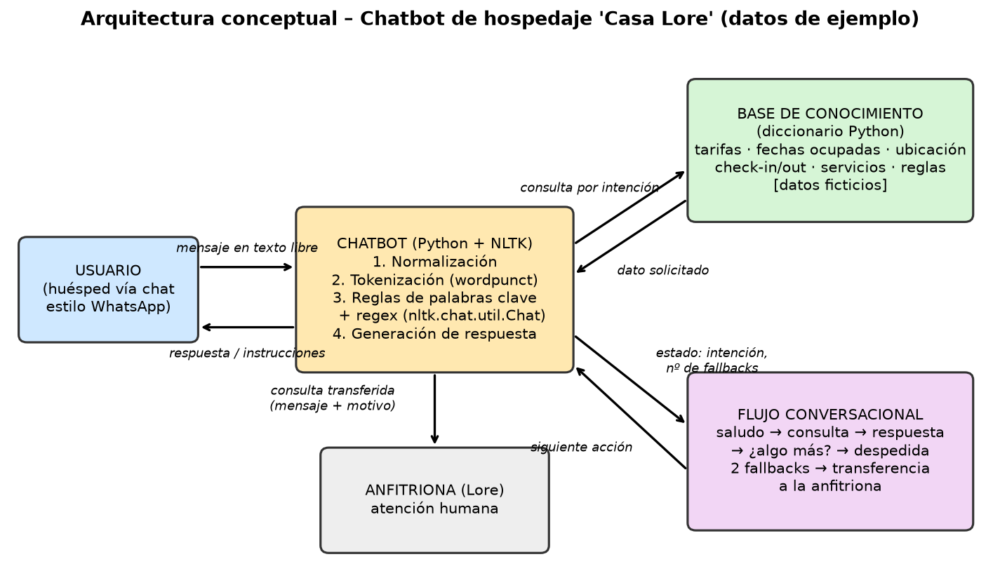

# Chatbot de hospedaje vacacional "Casa Lore" (basado en reglas con NLTK)

**Avance de proyecto 1 · Desarrollo de aplicaciones con IA · Maestría en Inteligencia Artificial, Tecmilenio**
Autor: José Pablo Herrera · Matrícula 07317961

> ⚠️ **Todos los datos del hospedaje (nombre, dirección, tarifas, teléfono, Wi-Fi, fechas ocupadas, códigos) son DATOS DE EJEMPLO / FICTICIOS.** No corresponden a ningún hospedaje, cliente ni persona real.

- Repositorio: [PENDIENTE: URL del repo]
- Notebook en Colab: [PENDIENTE: link de Colab]

## Datos
Todos los datos del hospedaje son **ficticios** (datos de ejemplo creados para este trabajo académico).

## Descripción
Chatbot conversacional basado en reglas que atiende a los huéspedes de un hospedaje vacacional cuya anfitriona es Lore. Responde dudas frecuentes (tarifas, disponibilidad, ubicación, check-in/check-out, servicios y reglas) y transfiere la conversación a la anfitriona cuando el huésped lo pide o cuando el bot no entiende.

## Funcionalidades
- **Preprocesamiento con NLTK:** normalización (minúsculas, sin acentos, conserva la ñ) y tokenización con `wordpunct_tokenize`. No requiere descargar corpus.
- **14 intenciones por palabras clave:** `contactar_anfitrion`, `porton_estacionamiento`, `cerradura`, `acceso_fraccionamiento`, `checkout`, `checkin_llegada`, `disponibilidad`, `tarifas`, `ubicacion`, `servicios`, `reglas`, `agradecimiento`, `despedida`, `saludo`. Ante empate se usa el orden de la lista como prioridad; si un mensaje agradece y se despide, gana `despedida`.
- **Respaldo con expresiones regulares** (`nltk.chat.util.Chat`) para frases como "¿eres un bot?" o "ok / de acuerdo".
- **Consulta de disponibilidad por fecha:** extrae la fecha del mensaje y la compara con las noches ocupadas de ejemplo.
- **Transferencia a Lore (humano):** cuando el huésped la solicita o tras 2 mensajes no entendidos seguidos.
- **Modo pruebas y modo interactivo.**

## Arquitectura


Flujo: mensaje del usuario → preprocesamiento (NLTK) → identificación de intención por palabras clave → respaldo regex → fallback / escalamiento a Lore → respuesta generada desde la base de conocimiento (ficticia).

## Requisitos
- Python 3.10 o superior
- NLTK (`pip install -r requirements.txt`)

## Cómo ejecutar
```bash
pip install -r requirements.txt
python chatbot_hospedaje.py          # ejecuta las conversaciones de prueba
python chatbot_hospedaje.py --chat   # modo interactivo
```
**Colab:** abre `chatbot_hospedaje.ipynb` en Google Colab y ejecuta *Entorno de ejecución → Ejecutar todas*. El notebook es autocontenido (no necesita otros archivos) y su penúltima celda verifica la intención esperada en los 26 turnos; el modo interactivo es opcional (`MODO_INTERACTIVO = True`) ([PENDIENTE: link de Colab]).

## Resultados de pruebas
La salida completa está en `evidencias_pruebas.txt` (Python 3.13.5, NLTK 3.10.3):
- 12 conversaciones, 26 turnos.
- **26 de 26 turnos con la intención correcta.**
- 2 turnos cayeron en fallback (mensajes fuera de dominio, a propósito); el segundo activó la transferencia a Lore como estaba previsto.

## Limitaciones conocidas y mejoras
- **Sin manejo de sinónimos:** solo reconoce las palabras clave definidas. En una prueba adicional, "¿tienen red inalámbrica?" cayó en fallback y "¿dónde aparco?" se clasificó como `ubicacion`. *Mejora:* lematización y sinónimos de WordNet (Open Multilingual WordNet en NLTK) para ampliar el vocabulario.
- **Sin contexto entre turnos:** cada mensaje se analiza por separado; el único estado es el contador de fallbacks. "¿y el 7 de noviembre?" sin la palabra "disponible" cae en fallback. *Mejora (Avance 2):* clasificador de intenciones con TF-IDF y estado del diálogo (última intención y datos extraídos).
- La base de conocimiento es estática y ficticia.

## Registro de ajustes
- `"Gracias, adiós"` se clasificaba como `agradecimiento` (empate y orden de prioridad). Se agregó una regla de desempate: si gana `agradecimiento` y aparece una palabra de cierre (`adios`, `bye`, `vemos`, `salu2`), gana `despedida`. Tras re-ejecutar las 12 conversaciones: 26/26 correctos.

## Próximas fases
1. **Avance 2:** clasificación de intenciones con aprendizaje automático (TF-IDF / Bolsa de palabras con Naive Bayes / SVM).
2. **Visión por computadora:** CNN con transferencia de aprendizaje (ResNet50 o EfficientNet).
3. **Proyecto final:** interfaz con Streamlit / API con Flask y despliegue en la nube.

## Referencias
Adamopoulou, E., & Moussiades, L. (2020). Chatbots: History, technology, and applications. *Machine Learning with Applications, 2*, Artículo 100006. https://doi.org/10.1016/j.mlwa.2020.100006

Bird, S., Klein, E., & Loper, E. (2009). *Natural language processing with Python: Analyzing text with the Natural Language Toolkit*. O'Reilly Media. https://www.nltk.org/book/

Jurafsky, D., & Martin, J. H. (2024). *Speech and language processing* (3.ª ed., borrador). Stanford University. https://web.stanford.edu/~jurafsky/slp3/

NLTK Project. (s. f.). *nltk.chat.util module*. NLTK documentation. Recuperado el 20 de octubre de 2026, de https://www.nltk.org/api/nltk.chat.util.html

Universidad Tecmilenio. (2026a). *Tema 3: Fundamentos de chatbots y NLP* [Material del curso Desarrollo de aplicaciones con IA]. Canvas. https://cursos.tecmilenio.mx/courses/254558/modules

Universidad Tecmilenio. (2026b). *Tema 4: Implementación de chatbots basados en reglas* [Material del curso Desarrollo de aplicaciones con IA]. Canvas. https://cursos.tecmilenio.mx/courses/254558/modules

Weizenbaum, J. (1966). ELIZA—A computer program for the study of natural language communication between man and machine. *Communications of the ACM, 9*(1), 36–45. https://doi.org/10.1145/365153.365168

## Licencia
MIT. Ver `LICENSE`.
