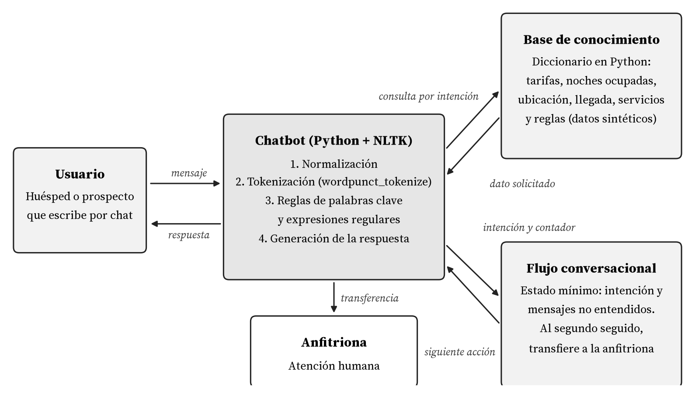

# Chatbot de hospedaje para Cas'aguacate (basado en reglas con NLTK)

**Avance de proyecto 1, actualizado para el Proyecto Final · Desarrollo de aplicaciones con IA · Maestría en Inteligencia Artificial, Tecmilenio**
Autor: José Pablo Herrera · Matrícula 07317961

> **Caso real:** Cas'aguacate, hotel boutique tipo aparthotel en La Asunción, Belén, Heredia, Costa Rica (anfitriona: Lore). El nombre y los datos del negocio se usan con permiso de los anfitriones. No hay datos de huéspedes. Los números de cuenta, la clave del Wi-Fi y los códigos de acceso **no** se publican: cada huésped los recibe en su bienvenida. Las noches ocupadas son fechas de ejemplo para demostrar la consulta de disponibilidad.

- Repositorio: https://github.com/jospabloh/chatbot-hospedaje-nltk
- Notebook en Colab: https://colab.research.google.com/drive/17jvLqa5cBCtA13wjWYAhjcBPQ9rNwuk3

## Datos
- Del negocio (información para huéspedes que compartió Cas'aguacate): check-in 15:00 y check-out 11:00; código de 4 dígitos por huésped, el mismo para el acceso peatonal y la habitación; no se aceptan mascotas ni visitas; no hay piscina; pagos por SINPE Móvil, transferencia BAC (colones o dólares) o tarjeta; factura electrónica o tiquete electrónico; reservas en reservations.casaguacate@gmail.com.
- Las tarifas no se publican: dependen de la habitación y las fechas, y el bot remite a reservas o a Lore.
- Hasta el Avance 1 el bot usaba datos de ejemplo ("Casa Almendro", anfitriona "Marina", tarifas en MXN). Se reemplazaron en la rama `proyecto-final`.

## Descripción
Chatbot conversacional bilingüe (español e inglés) basado en reglas que atiende a los huéspedes de Cas'aguacate, cuya anfitriona es Lore. Responde dudas frecuentes (tarifas, pagos y facturación, disponibilidad, ubicación, check-in/check-out, servicios y reglas) y transfiere la conversación a la anfitriona cuando el huésped lo pide o cuando el bot no entiende. Los dueños hablan español y los huéspedes son internacionales, por lo que el bot detecta el idioma de cada mensaje y responde en el mismo idioma.

## Funcionalidades
- **Preprocesamiento con NLTK:** normalización (minúsculas, sin acentos, conserva la ñ) y tokenización con `wordpunct_tokenize`. Stemming con `SnowballStemmer("spanish")` y `PorterStemmer` como respaldo para formas flexionadas. No requiere descargar corpus.
- **Detección de idioma (español/inglés):** cuenta palabras funcionales frecuentes de cada idioma (listas tipo *stopwords* incluidas en el código); ante empate conserva el idioma del turno anterior. Si el huésped cambia de idioma, el bot cambia con él.
- **15 intenciones por palabras clave en ambos idiomas:** `contact_host`, `parking_gate`, `door_lock`, `community_access`, `checkout`, `checkin_arrival`, `availability`, `payment`, `rates`, `location`, `amenities`, `house_rules`, `thanks`, `goodbye`, `greeting`. Ante empate se usa el orden de la lista como prioridad; si un mensaje agradece y se despide, gana `goodbye`.
- **Respaldo con expresiones regulares** (`nltk.chat.util.Chat`), un conjunto por idioma, para frases como "¿eres un bot?" / "are you a bot?" u "ok / de acuerdo".
- **Consulta de disponibilidad por fecha:** extrae la fecha del mensaje ("14 de noviembre", "November 14", "14th of Nov") y la compara con las noches ocupadas de ejemplo.
- **Transferencia a Lore (humano):** cuando el huésped la solicita o tras 2 mensajes no entendidos seguidos.
- **Modo pruebas y modo interactivo.**

## Arquitectura


Flujo: mensaje del usuario → detección de idioma → preprocesamiento (NLTK) → identificación de intención por palabras clave → respaldo regex → fallback / escalamiento a Lore → respuesta en el idioma del huésped generada desde la base de conocimiento de Cas'aguacate. (El diagrama conserva los nombres del Avance 1.) El código (identificadores, funciones, comentarios y docstrings) está escrito en inglés; las respuestas al huésped están en español o inglés.

## Requisitos
- Python 3.10 o superior
- NLTK (`pip install -r requirements.txt`)

## Cómo ejecutar
```bash
pip install -r requirements.txt
python chatbot_hospedaje.py          # ejecuta las conversaciones de prueba
python chatbot_hospedaje.py --chat   # modo interactivo
```
**Colab:** abre `chatbot_hospedaje.ipynb` en Google Colab y ejecuta *Entorno de ejecución → Ejecutar todas*. El notebook es autocontenido (no necesita otros archivos) y su penúltima celda verifica la intención esperada en los turnos de prueba; el modo interactivo es opcional (`MODO_INTERACTIVO = True`).

## Resultados de pruebas
La salida completa está en `evidencias_pruebas.txt` (Python 3.9.6, NLTK 3.9.2):
- 26 conversaciones (13 en español, 12 en inglés y 1 con cambio de idioma), 61 turnos.
- **61 de 61 turnos con la intención y el idioma correctos.**
- **10 de 10 casos de detección de idioma correctos.**
- **13 de 13 verificaciones de datos del negocio**: el bot no responde precios en MXN, dice que no hay piscina y que no se aceptan mascotas, da los medios de pago y la ubicación reales, y ninguna respuesta menciona Casa Almendro, Marina, Las Palmas ni MXN.
- 4 turnos cayeron en fallback (mensajes fuera de dominio, a propósito, 2 por idioma); el segundo de cada conversación activó la transferencia a Lore como estaba previsto.

## Proyecto Final: fotos reales
`proyecto_final/fotos_reales/` mide el clasificador visual del Avance 2 (ResNet50) con las imágenes reales que envió Cas'aguacate. Ver su README.

## Limitaciones conocidas y mejoras
- **Sin manejo de sinónimos:** solo reconoce las palabras clave definidas. En una prueba adicional, "¿tienen red inalámbrica?" cayó en fallback y "¿dónde aparco?" se clasificó como `ubicacion`. *Mejora:* lematización y sinónimos de WordNet (Open Multilingual WordNet en NLTK) para ampliar el vocabulario.
- **Sin contexto entre turnos:** cada mensaje se analiza por separado; el único estado es el contador de fallbacks. Un mensaje que solo menciona una fecha ("¿y el 20 de noviembre?") se interpreta como consulta de disponibilidad, pero no se recuerdan otros datos. *Mejora (Avance 2):* clasificador de intenciones con TF-IDF y estado del diálogo (última intención y datos extraídos).
- **Detección de idioma por reglas:** mensajes muy cortos o sin palabras funcionales ("wifi?", "ok") conservan el idioma anterior (español al inicio); no distingue otros idiomas, que se tratan como español o inglés.
- La base de conocimiento es estática; las tarifas y la disponibilidad reales no están conectadas.

## Registro de ajustes
- `"Gracias, adiós"` se clasificaba como `agradecimiento` (empate y orden de prioridad). Se agregó una regla de desempate: si gana `agradecimiento` y aparece una palabra de cierre (`adios`, `bye`, `vemos`, `salu2`), gana `despedida`. Tras re-ejecutar las 12 conversaciones: 26/26 correctos.
- Versión bilingüe: se tradujo el código a inglés, se agregaron palabras clave en inglés y la detección de idioma. En la primera ejecución "¿Cómo abro el portón?" se clasificó mal porque el stemming sumaba coincidencias extra; se ajustó para usar los stems solo cuando no hay coincidencia exacta. Tras re-ejecutar: 55/55 correctos, y las respuestas en español son idénticas a las de la versión anterior.

## Próximas fases
1. **Avance 2:** clasificación de intenciones con aprendizaje automático (TF-IDF / Bolsa de palabras con Naive Bayes / SVM).
2. **Visión por computadora:** CNN con transferencia de aprendizaje (ResNet50 o EfficientNet).
3. **Proyecto final:** interfaz con Streamlit / API con Flask y despliegue en la nube.

## Referencias
Adamopoulou, E., & Moussiades, L. (2020). Chatbots: History, technology, and applications. *Machine Learning with Applications, 2*, Artículo 100006. https://doi.org/10.1016/j.mlwa.2020.100006

Bird, S., Klein, E., & Loper, E. (2009). *Natural language processing with Python: Analyzing text with the Natural Language Toolkit*. O'Reilly Media. https://www.nltk.org/book/

Jurafsky, D., & Martin, J. H. (2024). *Speech and language processing* (3.ª ed., versión preliminar). Stanford University. https://web.stanford.edu/~jurafsky/slp3/

NLTK Project. (s. f.). *nltk.chat.util module*. NLTK documentation. Recuperado el 20 de octubre de 2026, de https://www.nltk.org/api/nltk.chat.util.html

Universidad Tecmilenio. (2026a). *Tema 3: Fundamentos de chatbots y NLP* [Material del curso Desarrollo de aplicaciones con IA]. Canvas. https://cursos.tecmilenio.mx/courses/254558/modules

Universidad Tecmilenio. (2026b). *Tema 4: Implementación de chatbots basados en reglas* [Material del curso Desarrollo de aplicaciones con IA]. Canvas. https://cursos.tecmilenio.mx/courses/254558/modules

Weizenbaum, J. (1966). ELIZA—A computer program for the study of natural language communication between man and machine. *Communications of the ACM, 9*(1), 36–45. https://doi.org/10.1145/365153.365168

## Licencia
MIT. Ver `LICENSE`.
