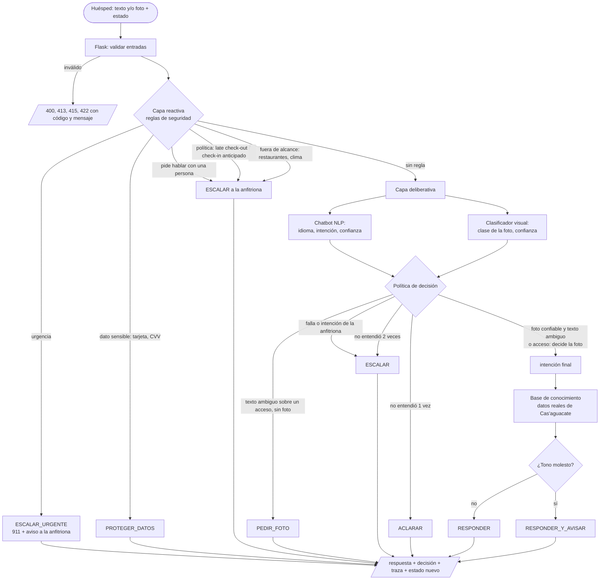
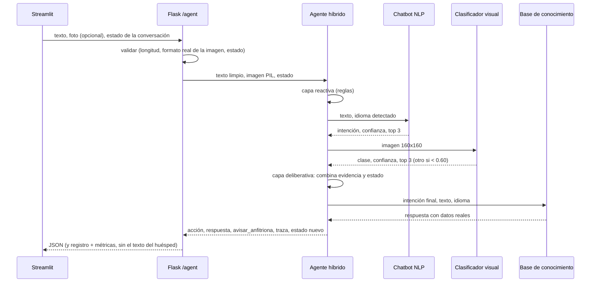

# Flujo de coordinación entre el chatbot, el clasificador visual y el agente

El agente es **híbrido**: una capa reactiva (reglas rápidas de seguridad, sin modelos) y una capa deliberativa
(estado de la conversación del huésped y política de decisión) que decide qué servicio llamar.

## Flujo de decisión de `POST /agent`

## Intercambio de información entre componentes

## Qué recibe y devuelve cada componente

| Componente | Entrada | Salida |
|---|---|---|
| Capa reactiva | texto normalizado | regla activada o nada (y marca de tono molesto) |
| Chatbot NLP | texto, idioma | intención (14), confianza, top 3 |
| Clasificador visual | foto 160x160 | clase (cerradura, porton, caseta, controles, interior, otro), confianza, top 3 |
| Capa deliberativa | salidas anteriores + estado | acción, intención final, quién decidió, motivo |
| Base de conocimiento | intención final, texto, idioma | texto de respuesta (sin códigos de acceso ni claves) |

## Estado de la conversación

Viaja con cada petición (el cliente lo guarda y lo reenvía), así que la API no guarda nada del huésped:

| Campo | Uso |
|---|---|
| `idioma` | último idioma del huésped, desempata mensajes cortos |
| `turnos` | número de turnos |
| `fallos` | mensajes seguidos que el asistente no entendió (a 2, escala) |
| `pidio_foto` | ya se pidió una foto en este problema (no se pide dos veces) |
| `intencion_pendiente` | intención que se espera confirmar con la foto |
| `escalada` | ya se avisó a la anfitriona en esta conversación |

## Acciones

`RESPONDER`, `RESPONDER_Y_AVISAR`, `PEDIR_FOTO`, `ACLARAR`, `ESCALAR`, `ESCALAR_URGENTE`, `PROTEGER_DATOS`.
Las que marcan `avisar_anfitriona = true`: `RESPONDER_Y_AVISAR`, `ESCALAR`, `ESCALAR_URGENTE`.

Nota: en esta versión el aviso se marca, se registra (`evento: aviso_anfitriona`) y se cuenta en `/metrics`;
el canal que lo entrega a la anfitriona (correo o WhatsApp) es una mejora futura.
