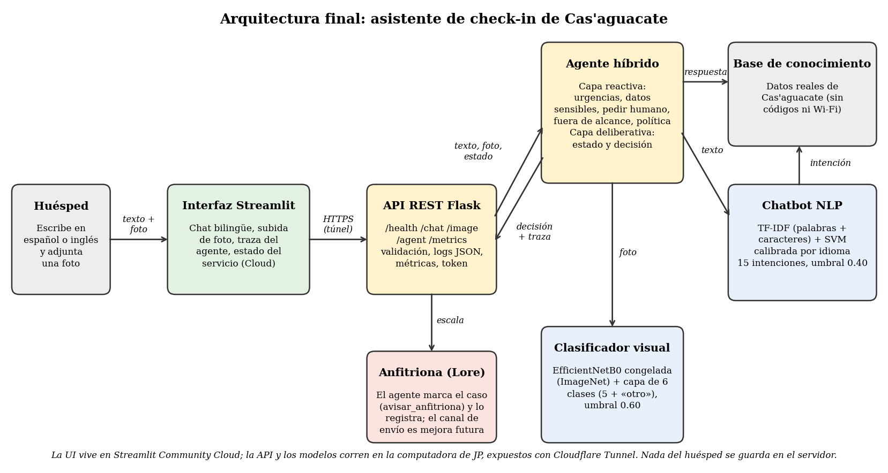
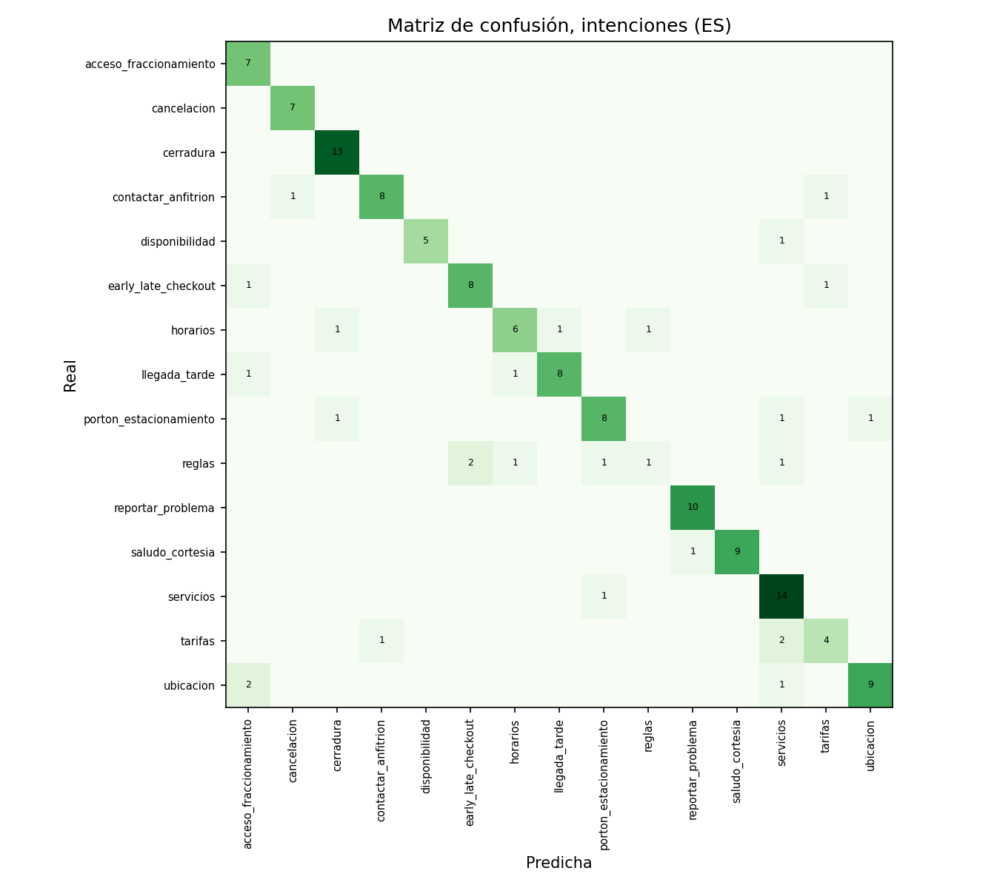
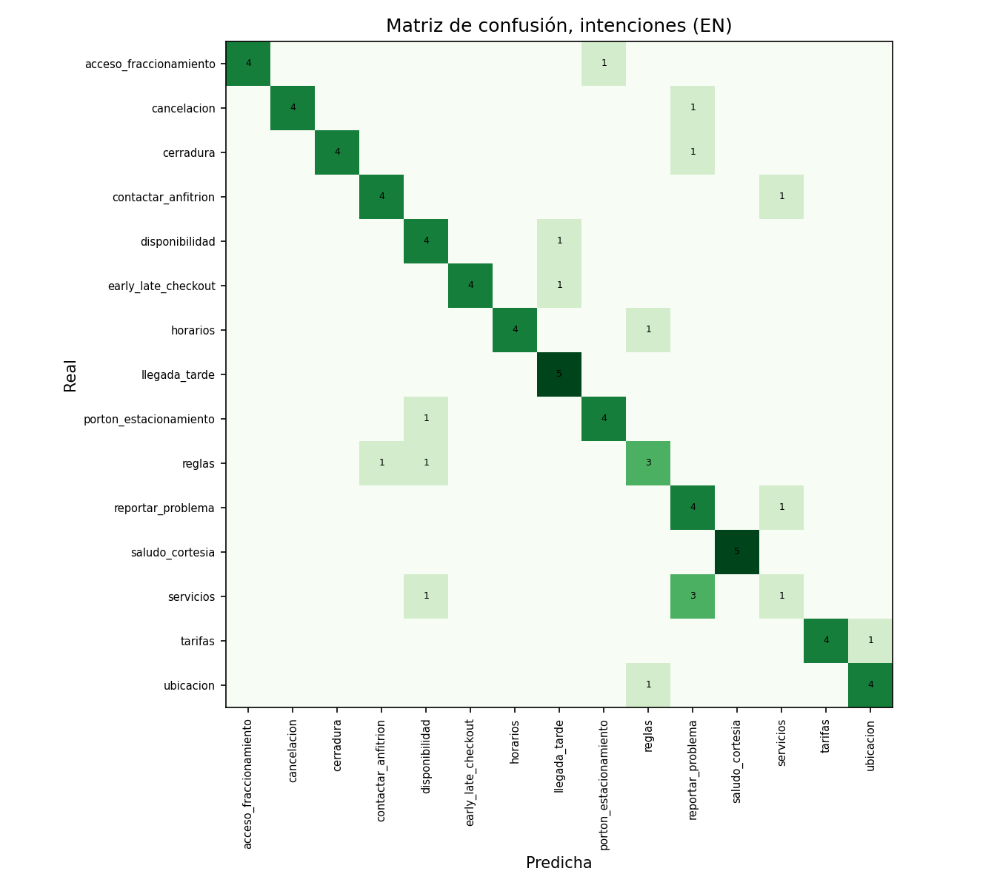
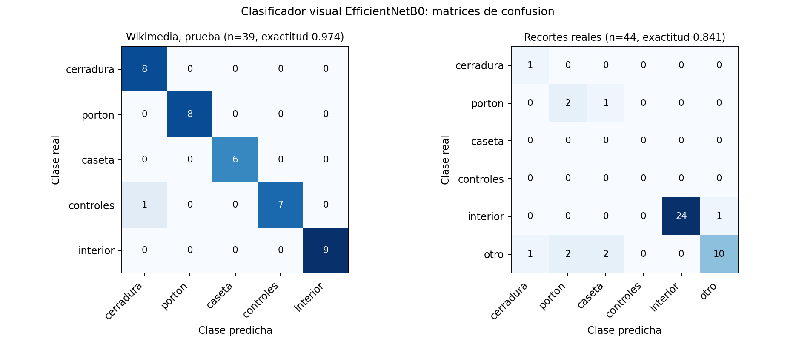
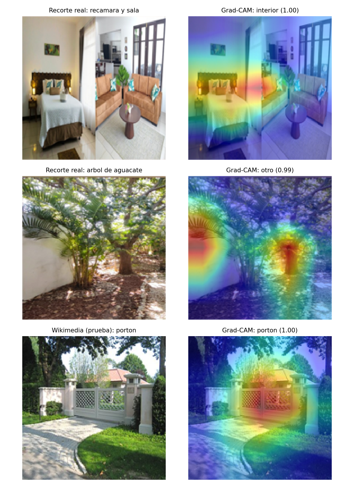
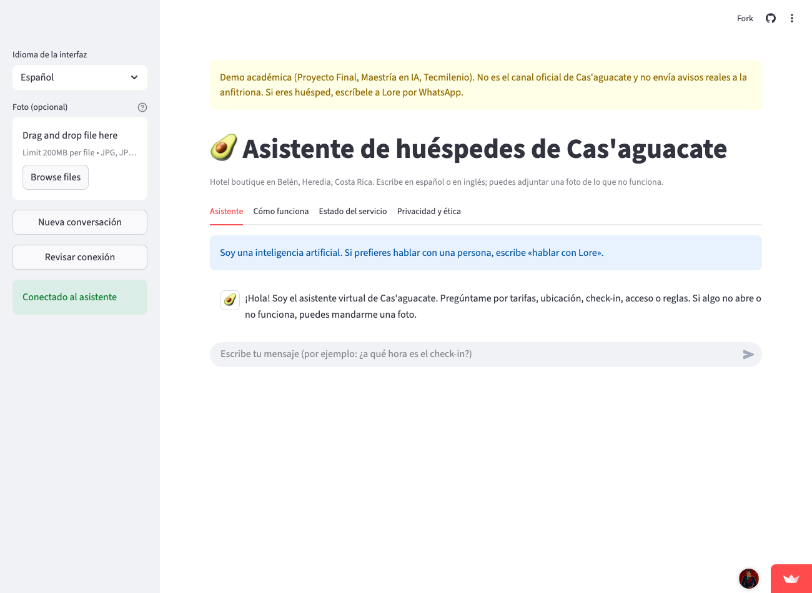

<div class="portada">

<p class="inst">Tecmilenio · Maestría en Inteligencia Artificial</p>

<h1 class="titulo-doc">Asistente inteligente de check-in para Cas'aguacate</h1>

<p class="subt">Aplicación web con chatbot de PLN, clasificador visual y agente híbrido, desplegada con API REST</p>

<p class="datos"><strong>Proyecto Final</strong><br>
Curso: Desarrollo de aplicaciones con inteligencia artificial (CC.MBIA2602FLE)</p>

<p class="datos"><strong>Autor:</strong> José Pablo Herrera Fernández<br>
<strong>Matrícula:</strong> al07317961</p>

<p class="datos"><strong>Fecha de entrega:</strong> 4 de diciembre de 2026</p>

<p class="datos"><strong>Repositorio:</strong> github.com/jospabloh/chatbot-hospedaje-nltk (rama <code>proyecto-final</code>)<br>
<strong>Interfaz pública:</strong> hospedaje-asistente-ia.streamlit.app</p>

<p class="aviso-portada">Demostración académica. No es el canal oficial de Cas'aguacate.</p>

</div>

<div class="pb"></div>

## Resumen

Este documento describe el diseño, la implementación, la evaluación y el despliegue de un asistente de check-in para Cas'aguacate, un hospedaje pequeño ubicado en La Asunción de Belén, Heredia, Costa Rica. El sistema integra tres componentes de inteligencia artificial en una aplicación web: un chatbot de procesamiento de lenguaje natural (PLN) bilingüe (español e inglés) que clasifica 15 intenciones, un clasificador visual basado en EfficientNetB0 que reconoce fotografías de los accesos de la propiedad, y un agente híbrido que combina una capa reactiva de reglas de seguridad con una capa deliberativa que decide si responder, pedir una foto, aclarar o escalar el caso a la anfitriona. La interfaz está construida con Streamlit y consume una API REST en Flask con validación de entradas, códigos de error estables, límite de peticiones, registros estructurados y un endpoint de métricas.

En la evaluación, el clasificador de intenciones obtiene una exactitud de 0.818 en español y 0.773 en inglés sobre particiones de prueba de 143 y 75 frases, con un F1 macro por validación cruzada de 0.704 y 0.700, y un área bajo la curva ROC uno contra el resto (AUC OvR) macro de 0.963 y 0.968. El clasificador visual de despliegue alcanza una exactitud de 0.974 sobre una partición de 39 imágenes de Wikimedia Commons y de 0.841 sobre 44 recortes de fotografías reales del hotel, con la advertencia explícita de que estas últimas tienen clases con uno a tres ejemplos. La suite de pruebas automatizadas consta de 218 pruebas que pasan, y una prueba de humo de 9 comprobaciones contra la API en ejecución pasó completa. El documento también analiza desempeño, escalabilidad, mantenibilidad, ética y sesgos, reconoce las limitaciones del sistema y propone un plan de mejoras futuras.

**Palabras clave:** agente inteligente, chatbot, visión por computadora, Grad-CAM, Flask, Streamlit, despliegue.

## 1. Introducción

Cas'aguacate es un hospedaje de escala pequeña en el que la anfitriona atiende de forma manual, principalmente por WhatsApp, las dudas de los huéspedes durante la llegada: horarios de entrada y salida, cómo abrir la cerradura o el portón, cómo ingresar al fraccionamiento, dónde estacionar, tarifas y reglas de la casa. Gran parte de esas preguntas se repite y tiene una respuesta que ya está definida por el negocio, pero otras requieren criterio humano: una llegada fuera de horario, una falla en un servicio, un reembolso o una urgencia.

El propósito del sistema es automatizar la parte repetible de esa atención, sin sustituir a la anfitriona en lo que le corresponde. El criterio de diseño se resume en una frase: el asistente responde solo cuando puede hacerlo con datos reales del negocio y con suficiente confianza, y en cualquier otro caso escala. Esta decisión es deliberada. En un servicio donde un huésped puede estar frente a un portón cerrado por la noche, una respuesta inventada es más costosa que una respuesta que dice «voy a avisar a la anfitriona».

El trabajo se desarrolló a lo largo del certificado en tres entregas. El Avance 1 produjo un chatbot basado en reglas con la base de conocimiento del negocio. El Avance 2 incorporó el clasificador de intenciones con aprendizaje automático, un clasificador de imágenes y su integración. El Proyecto Final, que se documenta aquí, agrega el agente híbrido, la API REST, la interfaz web, las pruebas, el despliegue y el análisis de calidad. La aplicación es una demostración académica; así lo declara un aviso fijo en la interfaz y no envía mensajes reales a la anfitriona.

El resto del documento se organiza de la siguiente manera. La sección 2 formula el problema y los objetivos. La sección 3 describe la metodología. Las secciones 4 a 8 presentan la arquitectura y cada componente. La sección 9 explica el flujo de integración, la sección 10 el despliegue, y las secciones 11 y 12 las pruebas, las métricas y el análisis de desempeño, escalabilidad y mantenibilidad. Las secciones 13 a 15 tratan la ética, el campo de aplicación y las limitaciones; la 16 presenta el plan de mejoras futuras, y la 17 las conclusiones.

## 2. Problema y objetivos

### 2.1 Descripción del problema

Los huéspedes de un hospedaje pequeño escriben a cualquier hora, en español o en inglés, con frases cortas, con errores de ortografía y, con frecuencia, sin contexto («no me abre»). Esa frase puede referirse a la cerradura de la puerta, al portón de la propiedad o a la caseta de acceso del fraccionamiento, y la respuesta correcta es distinta en cada caso. Un huésped también puede enviar una fotografía de lo que no funciona, y esa fotografía contiene información que el texto no tiene.

Los usuarios del sistema son tres: el huésped, que necesita una respuesta rápida y correcta; la anfitriona, que necesita recibir solo los casos que requieren su atención; y el dueño del negocio, que necesita saber que el asistente no revela datos sensibles ni inventa políticas.

### 2.2 Objetivo general

Construir y desplegar una aplicación web que atienda el check-in de Cas'aguacate integrando un chatbot de PLN, un clasificador visual y un agente que decida cuándo responder y cuándo escalar, con un flujo documentado, pruebas automatizadas y métricas de calidad.

### 2.3 Objetivos específicos

1. Clasificar la intención de mensajes en español e inglés con un modelo evaluado con matriz de confusión, AUC y F1 macro.
2. Reconocer fotografías de los accesos (cerradura, portón, caseta, controles, interior) y rechazar las que no pertenecen al dominio mediante una clase «otro» y un umbral de confianza.
3. Implementar un agente que perciba, decida y actúe, con reglas de seguridad que no dependan de los modelos de aprendizaje.
4. Exponer los servicios mediante una API REST con manejo de errores, validación, registros y métricas, y consumirla desde una interfaz Streamlit.
5. Desplegar la aplicación con una URL pública y reunir evidencias de pruebas y de despliegue.
6. Analizar desempeño, escalabilidad, mantenibilidad, ética y sesgos, y proponer mejoras.

## 3. Metodología

### 3.1 Datos

El corpus de intenciones fue elaborado para el proyecto y contiene 711 frases en español y 375 en inglés, distribuidas en 15 intenciones (tarifas, ubicación, cerradura, portón y estacionamiento, acceso al fraccionamiento, servicios, reglas, horarios, llegada tarde, early o late check-out, disponibilidad, reportar un problema, contactar a la anfitriona, saludo y cortesía, y cancelación). La intención de cancelación se incorporó durante el Proyecto Final a partir de un hallazgo de pruebas: la interfaz pública respondía «no entendí» a la pregunta de cómo cancelar una reservación. La respuesta de cancelación es general y no incluye plazos ni montos, porque el repositorio no contiene una política de cancelación del negocio.

Para visión se usan dos fuentes. La primera es un conjunto de imágenes públicas de Wikimedia Commons (256 imágenes únicas tras eliminar casi duplicados con un hash perceptual, y 6 imágenes fuera de dominio), cuyos créditos están en el repositorio. La segunda son las imágenes reales que envió el negocio: 33 páginas de un folleto del hotel, de las cuales se extrajeron 44 recortes útiles (25 de interiores, 15 de otro tipo, 3 de portón y 1 de cerradura). No hay recortes de caseta ni de controles. Estas fotografías no se publican en el repositorio porque muestran accesos de la propiedad; solo se guardan las etiquetas y las métricas.

### 3.2 Partición, semillas y métricas

Todas las particiones son reproducibles con la semilla 42. El texto se divide 80/20 con estratificación por intención. Las imágenes de Wikimedia se dividen 70/15/15, también estratificadas. Para las fotografías reales se usa validación dejando fuera una toma completa por vez, de modo que una misma escena nunca esté en entrenamiento y en prueba a la vez. Las métricas de clasificación son exactitud, precisión, exhaustividad (recall), F1 por clase y F1 macro, matriz de confusión, AUC uno contra el resto y precisión promedio (Fawcett, 2006; Saito y Rehmsmeier, 2015). Dado que las clases están desbalanceadas, se prefiere el F1 macro a la exactitud para comparar versiones (He y Garcia, 2009).

### 3.3 Herramientas

El núcleo está escrito en Python. El PLN usa scikit-learn (Pedregosa et al., 2011) y NLTK (Bird et al., 2009); la visión usa TensorFlow y Keras (Abadi et al., 2016; Chollet, 2015); la API usa Flask y gunicorn; la interfaz usa Streamlit; las pruebas usan pytest; y el túnel de acceso usa Cloudflare Tunnel. Las versiones fijadas están en `proyecto_final/app/requirements.txt` (Flask 3.1.3, gunicorn 23.0.0, scikit-learn 1.6.1, TensorFlow 2.16.2, NLTK 3.9.2).

[NOTA_USO_IA]

## 4. Arquitectura general

El sistema se organiza en capas con responsabilidades separadas (figura 1). El huésped interactúa con una interfaz Streamlit, que envía texto, fotografía opcional y el estado de la conversación a una API REST en Flask. La API valida las entradas y entrega el caso al agente híbrido, que consulta al chatbot de PLN, al clasificador visual y a la base de conocimiento, y devuelve una acción, una respuesta y una traza de decisiones.

<figure>

<figcaption><strong>Figura 1.</strong> Arquitectura final. Fuente: <code>app/docs/arquitectura_final.png</code>, generada con <code>scripts/figura_arquitectura_final.py</code>.</figcaption>
</figure>

Tres decisiones de diseño merecen explicación.

**La API no guarda nada del huésped.** El estado de la conversación (idioma, número de turnos, fallos consecutivos, si ya se pidió una foto, intención pendiente y si ya se escaló) viaja en cada petición y regresa en la respuesta. El cliente lo conserva. Esto simplifica el despliegue, elimina una base de datos con datos personales y facilita las pruebas, a costa de que el servidor no pueda reconstruir una conversación por su cuenta.

**Los modelos se cargan una vez y se comparten.** El clasificador de intenciones (un archivo `.joblib` por idioma) y la cabeza del clasificador visual (100 KB) están en el repositorio; los pesos del backbone de imágenes se descargan de Keras la primera vez. Si el backbone no se puede cargar, la API arranca de todos modos, `/health` lo informa y las fotografías reciben una respuesta amable en lugar de un error.

**La base de conocimiento es única.** Las respuestas viven en el módulo del Avance 1, de modo que los datos del negocio tienen una sola fuente. Los códigos de acceso, las claves de Wi-Fi y los números de propiedad nunca se escriben ahí: el huésped los recibe en su mensaje de bienvenida y las respuestas solo indican dónde encontrarlos.

## 5. Módulo de procesamiento de lenguaje natural

### 5.1 Preprocesamiento y modelo

El texto se normaliza (minúsculas, sin acentos, conservando la letra «ñ», sin signos de puntuación y sin letras repetidas más de dos veces), se tokeniza con NLTK, se eliminan palabras vacías (stopwords) conservando las palabras que portan intención («no», «cuánto», «dónde», «antes», «tarde», entre otras) y se aplica stemming Snowball (Porter, 2001). El detector de idioma es heurístico, basado en marcadores léxicos de cada idioma, y se apoya en el idioma del turno anterior para desempatar mensajes cortos.

La representación combina TF-IDF de palabras (unigramas y bigramas, con ponderación sublineal) y TF-IDF de caracteres (n-gramas de 2 a 5 dentro de palabra), lo que da robustez ante errores de ortografía. El clasificador es una máquina de vectores de soporte lineal (LinearSVC, C = 0.5) envuelta en una calibración con validación cruzada de 5 particiones (CalibratedClassifierCV), que convierte los puntajes en probabilidades (Platt, 1999). Se entrena un modelo por idioma. Si la probabilidad de la intención ganadora es menor que 0.40, el chatbot no confía en su respuesta; este umbral gobierna la cobertura que se reporta más abajo.

### 5.2 Resultados

La tabla 1 resume los resultados sobre la partición de prueba. El F1 macro con validación cruzada de 5 particiones es la medida estable entre versiones del corpus, porque al agregar la intención de cancelación cambió la partición de prueba (de 137 a 143 frases en español y de 70 a 75 en inglés) y la exactitud de prueba dejó de ser comparable uno a uno con la versión anterior (0.752 en español).

**Tabla 1.** Clasificador de intenciones. Fuentes: `app/artefactos/metricas_texto.json` y `app/evidencias/metricas_evaluacion_texto.json`.

| Idioma | Frases | Prueba (n) | Exactitud | F1 macro | F1 macro CV (5) | AUC OvR macro | Precisión promedio macro | Cobertura (umbral 0.40) | Exactitud cubierta |
|---|---|---|---|---|---|---|---|---|---|
| Español | 711 | 143 | 0.818 | 0.792 | 0.704 ± 0.041 | 0.963 | 0.829 | 0.804 | 0.887 |
| Inglés | 375 | 75 | 0.773 | 0.777 | 0.700 ± 0.056 | 0.968 | 0.813 | 0.720 | 0.833 |

La cobertura es la proporción de mensajes de prueba cuya confianza supera el umbral, y la exactitud cubierta es la exactitud solo sobre esos mensajes. Con el umbral de 0.40 el sistema renuncia a contestar entre el 20 % y el 28 % de los mensajes, pero acierta en 0.887 (español) y 0.833 (inglés) de los que sí contesta. En la medición de mensajes fuera de alcance, el 37.5 % (español) y el 100 % (inglés) quedan bajo el umbral, según `metricas_texto.json`; el resultado en español muestra que un umbral de confianza por sí solo no basta para detectar todo lo que está fuera del dominio, y por eso el agente añade reglas explícitas de fuera de alcance (sección 7).

La figura 2 muestra las matrices de confusión de ambos idiomas. El AUC por intención es de 0.90 o más en todas las clases salvo, en español, «reglas» (0.794) y «ubicación» (0.839), de las cuales «reglas» coincide con la clase de peor F1 (0.250).

<figure>


<figcaption><strong>Figura 2.</strong> Matrices de confusión del clasificador de intenciones, español (izquierda, n = 143) e inglés (derecha, n = 75). Fuente: <code>app/evidencias/matriz_confusion_es.png</code> y <code>matriz_confusion_en.png</code>, generadas con <code>scripts/metricas_evaluacion.py</code>.</figcaption>
</figure>

### 5.3 Análisis de errores

En español las confusiones más frecuentes son «reglas» clasificada como «early o late check-out» (2 casos), «tarifas» como «servicios» (2) y «ubicación» como «acceso al fraccionamiento» (2). Son confusiones entre temas que comparten vocabulario: una pregunta sobre las reglas de la casa que menciona la hora de salida se parece a una de check-out, y una pregunta de ubicación que menciona la entrada del fraccionamiento se parece a una de acceso. En inglés el error dominante es «servicios» clasificado como «reportar un problema» (3 casos de 5), con una exhaustividad de 0.2 para esa clase. En ambos idiomas la clase más débil, «servicios» en inglés y «reglas» en español, tiene pocas frases de prueba (5 y 6), de modo que cada error pesa mucho en el F1.

**Tabla 2.** Rendimiento por intención en español (n = 143). Fuente: `app/evidencias/metricas_evaluacion_texto.json`.

| Intención | Precisión | Exhaustividad | F1 | Soporte |
|---|---|---|---|---|
| saludo y cortesía | 1.000 | 0.900 | 0.947 | 10 |
| reportar problema | 0.909 | 1.000 | 0.952 | 10 |
| cancelación | 0.875 | 1.000 | 0.933 | 7 |
| cerradura | 0.867 | 1.000 | 0.929 | 13 |
| disponibilidad | 1.000 | 0.833 | 0.909 | 6 |
| contactar a la anfitriona | 0.889 | 0.800 | 0.842 | 10 |
| llegada tarde | 0.889 | 0.800 | 0.842 | 10 |
| ubicación | 0.900 | 0.750 | 0.818 | 12 |
| early o late check-out | 0.800 | 0.800 | 0.800 | 10 |
| servicios | 0.700 | 0.933 | 0.800 | 15 |
| acceso al fraccionamiento | 0.636 | 1.000 | 0.778 | 7 |
| portón y estacionamiento | 0.800 | 0.727 | 0.762 | 11 |
| horarios | 0.750 | 0.667 | 0.706 | 9 |
| tarifas | 0.667 | 0.571 | 0.615 | 7 |
| reglas | 0.500 | 0.167 | 0.250 | 6 |

### 5.4 Desbalance e hiperparámetros del texto

Las intenciones no tienen el mismo número de frases (en el corpus del Avance 2, de 30 para «reglas» a 73 para «servicios»). Por eso se reportan el F1 macro y la precisión promedio, que no dejan que las clases grandes oculten el mal desempeño de las pequeñas. Los hiperparámetros (C = 0.5, n-gramas de palabras de 1 a 2, n-gramas de caracteres de 2 a 5, calibración con 5 particiones) se fijaron a partir del Avance 2, donde una ablación sobre 681 frases mostró que cada paso de preprocesamiento aporta poco por sí solo y que los n-gramas de caracteres son el cambio que más mejora: el F1 macro pasa de 0.633 con texto crudo a 0.723 con la configuración final (fuente: `avance2/salidas/resumen.json`). En el Avance 2 también se comparó Naive Bayes (F1 macro CV 0.660) con la SVM lineal (0.706), y se eligió esta última. No se realizó una búsqueda exhaustiva de hiperparámetros con el corpus actual; se declara como mejora futura.

El tono de la conversación se intentó modelar con el mismo enfoque, pero la exactitud fue de 0.611 en español (n = 36) y 0.556 en inglés (n = 18), con F1 macro de 0.603 y 0.557. Con tan pocos datos el modelo es demasiado débil, así que no se despliega y el tono molesto se detecta con un léxico en la capa reactiva. El ensamble con MiniLM del Avance 2 tampoco se despliega por su peso y sus dependencias; se cita solo como referencia.

## 6. Módulo de visión por computadora

### 6.1 Diseño

El clasificador visual reconoce seis clases: cerradura, portón, caseta, controles, interior y «otro». Se usa un backbone preentrenado en ImageNet (Deng et al., 2009) y congelado, con entrada de 160 x 160 píxeles, que produce un vector de características por promedio global. Sobre ese vector se entrena una cabeza pequeña: estandarización (StandardScaler) y regresión logística con C = 0.1 y `class_weight="balanced"`, que pondera las clases de forma inversa a su frecuencia para atender el desbalance. Si la confianza de la clase ganadora es menor que 0.60, la foto se trata como «otro»: no se etiqueta y se escala a la anfitriona.

Se optó por congelar el backbone y entrenar solo la cabeza por tres razones: el conjunto de imágenes propias es muy pequeño y un ajuste fino completo tendería a sobreajustarse; el artefacto que se versiona pesa 100 KB en lugar de decenas de megabytes; y el entrenamiento y la evaluación se reproducen en minutos en una computadora sin GPU. La contrapartida es que las características no se adaptan al dominio, lo que se refleja en el desempeño con fotografías reales.

### 6.2 Comparación de backbones

Se compararon tres arquitecturas con la misma cabeza y los mismos datos: ResNet50 (He et al., 2016), tomada como referencia; MobileNetV2 (Sandler et al., 2018); y EfficientNetB0 (Tan y Le, 2019). El criterio de selección, registrado en `vision_meta.json`, fue elegir el más ligero en memoria cuya exactitud estuviera a menos de 0.02 de la de ResNet50.

**Tabla 3.** Comparación de backbones. Fuentes: `app/artefactos/vision_meta.json` y `app/evidencias/entrenamiento_vision.txt`.

| Modelo | Exactitud Wikimedia (n = 39) | F1 macro Wikimedia | Exactitud fotos reales (n = 44) | F1 macro fotos reales | Peso (float32) | Latencia media CPU | Latencia p95 CPU | Memoria pico |
|---|---|---|---|---|---|---|---|---|
| ResNet50 (referencia) | 0.974 | 0.975 | 0.818 | 0.411 | 94.4 MB | 112.7 ms | 126.2 ms | 560 MB |
| MobileNetV2 | 0.897 | 0.898 | 0.795 | 0.442 | 9.0 MB | 51.1 ms | 54.4 ms | 517 MB |
| **EfficientNetB0 (despliegue)** | **0.974** | **0.975** | **0.841** | **0.597** | **16.2 MB** | **128.1 ms** | **206.7 ms** | **378 MB** |

EfficientNetB0 empata a ResNet50 en exactitud sobre Wikimedia, la supera en las fotografías reales, pesa casi seis veces menos y consume menos memoria pico. No es más rápido que ResNet50 (128.1 ms contra 112.7 ms en promedio, con un p95 de 206.7 ms), y MobileNetV2, el más veloz, pierde 7.7 puntos de exactitud en Wikimedia. Para un servicio que atiende a un huésped a la vez, una latencia de visión de décimas de segundo es aceptable y la memoria es la restricción relevante.

### 6.3 Matrices de confusión

La figura 3 presenta la matriz de confusión del modelo de despliegue en las dos pruebas. Sobre Wikimedia (n = 39) se cometió un solo error: una imagen de «controles» clasificada como «cerradura». Sobre los 44 recortes reales, el modelo acierta 24 de 25 interiores y 10 de 15 imágenes de «otro»; en las cinco restantes de «otro» predijo cerradura (1), portón (2) y caseta (2). De los tres portones reales acierta dos y confunde uno con caseta, y la única cerradura se clasifica bien. No hay ejemplos reales de caseta ni de controles, por lo que esas filas están vacías.

<figure>

<figcaption><strong>Figura 3.</strong> Matrices de confusión de EfficientNetB0. Izquierda: partición de prueba de Wikimedia. Derecha: recortes reales con validación dejando una toma fuera y regla de confianza 0.60. Fuente: <code>app/evidencias/matriz_confusion_vision.png</code>, generada con <code>scripts/figuras_vision.py</code> (la matriz de fotos reales proviene de <code>vision_meta.json</code>).</figcaption>
</figure>

La exactitud de 0.841 sobre fotografías reales debe leerse con cautela. El conjunto es muy desbalanceado (25 de 44 son interiores, una clase que el modelo reconoce con facilidad) y las clases de exterior tienen entre 1 y 3 ejemplos; por eso el F1 macro, que pondera todas las clases por igual, es solo 0.597. La cifra es indicativa y no concluyente. Una limitación adicional: los recortes provienen de un folleto de marketing, no de fotografías tomadas por un huésped frente a la cerradura, de modo que el dominio de prueba difiere del de uso.

### 6.4 Interpretabilidad con Grad-CAM

Para inspeccionar en qué se fija el modelo se calculó Grad-CAM (Selvaraju et al., 2017): el gradiente del puntaje de la clase ganadora respecto al último mapa convolucional da un peso por canal, y la combinación ponderada de los canales, filtrada por una ReLU, indica las zonas que empujan la decisión hacia esa clase. Como la cabeza es un modelo lineal sobre el promedio global del mapa, el puntaje se reconstruye en TensorFlow con los coeficientes de la cabeza y se deriva con `GradientTape`. El mapa de EfficientNetB0 con entrada de 160 x 160 tiene solo 5 x 5 celdas, por lo que se interpola y las zonas resultan amplias.

<figure>

<figcaption><strong>Figura 4.</strong> Grad-CAM con la cabeza de despliegue. Arriba: recorte real de una recámara y sala. Centro: recorte real del árbol de aguacate del jardín. Abajo: imagen de prueba de Wikimedia (portón). Fuente: <code>app/evidencias/gradcam_efficientnetb0.png</code> y <code>figuras_vision_resumen.json</code>, generados con <code>scripts/figuras_vision.py</code>.</figcaption>
</figure>

Los tres casos son informativos. En la recámara y sala (clasificada como «interior» con confianza 0.995) la activación se concentra en la zona de la cama y el cabecero, con extensión parcial hacia el sofá, es decir, el mobiliario típico de un interior. En el portón de Wikimedia (clase «portón», 0.995) se concentra en las hojas de la reja, que es el objeto que define la clase. En el árbol (clase «otro», 0.989) el mapa resalta el tronco y las palmas, y no hay ningún objeto de acceso. Una salvedad de honestidad: la cabeza de despliegue se entrena con todas las imágenes, incluidos estos recortes, de modo que la figura ilustra a qué atiende el modelo y no mide su capacidad de generalizar; esa capacidad se mide con las matrices de la figura 3. Se eligieron imágenes de interiores y de jardín, no de los accesos reales, para no publicar fotografías que muestren los puntos de entrada de la propiedad.

## 7. Agente inteligente

### 7.1 Percibir, decidir y actuar

El agente se describe con el ciclo clásico de percepción, decisión y acción (Russell y Norvig, 2021). El entorno es la conversación con un huésped. Sus sensores son el texto del mensaje, la fotografía opcional y el estado de la conversación; sus actuadores son la respuesta al huésped, el marcador de aviso a la anfitriona y la traza de decisiones. En cada turno el agente percibe (normaliza el texto, detecta el idioma, clasifica la intención y la foto), decide con las reglas y la política, y actúa devolviendo una de siete acciones: `RESPONDER`, `RESPONDER_Y_AVISAR`, `PEDIR_FOTO`, `ACLARAR`, `ESCALAR`, `ESCALAR_URGENTE` y `PROTEGER_DATOS`.

### 7.2 Arquitectura híbrida: capa reactiva y capa deliberativa

El agente es híbrido, en el sentido de las arquitecturas por capas descritas por Wooldridge (2009): una capa reactiva responde de inmediato a situaciones críticas, y una capa deliberativa razona con el estado y la evidencia de los modelos.

La **capa reactiva** son expresiones regulares sobre el texto normalizado, en español y en inglés, que se ejecutan antes de cualquier modelo y no pueden ser engañadas por una baja confianza del clasificador. Se evalúan con prioridad fija: primero urgencias (fuego, humo, fuga de gas, emergencias médicas, robo), que remiten al 911 y avisan a la anfitriona; después datos sensibles (números de tarjeta, CVV), que se rechazan sin procesar ni registrar; luego la petición explícita de hablar con una persona; luego la política de la anfitriona (early check-in y early o late check-out, que solo ella decide); y por último los temas fuera de alcance, como recomendar restaurantes. Además detecta tono molesto, que no bloquea la respuesta pero la convierte en `RESPONDER_Y_AVISAR`.

La **capa deliberativa** se activa si ninguna regla aplica. Combina la intención del texto y su confianza, la clase de la foto y su confianza, y el estado de la conversación. Si el texto es ambiguo sobre un acceso y no hay foto, pide una foto (`PEDIR_FOTO`), pero nunca dos veces en el mismo problema. Si hay una foto confiable y el texto es ambiguo, decide la foto. Si el asistente no entendió, aclara una vez (`ACLARAR`), y si no entiende por segunda vez consecutiva escala. Las intenciones que el negocio reserva a la anfitriona (contactarla y los cambios de horario de entrada o salida) se escalan. Un reporte de problema primero pide una foto, una sola vez, y después se escala, porque las fallas las revisa la anfitriona. Las cancelaciones y los reembolsos se responden con un texto general y además se avisa a la anfitriona (`RESPONDER_Y_AVISAR`). El umbral de texto es 0.40, el de texto ambiguo con foto confiable es 0.60, el de imagen es 0.60 y el máximo de aclaraciones fallidas es 2.

La figura 5 resume el flujo de decisión; el diagrama de secuencia completo está en `app/docs/flujo_coordinacion.md`.

<figure>
<pre class="flujo">Huésped: texto y/o foto + estado
        |
        v
Flask: validar entradas ------ inválidas ------> 400, 413, 415, 422 (código y mensaje)
        |
        v
CAPA REACTIVA (reglas, sin modelos), en este orden
   1. urgencia ............ ESCALAR_URGENTE (911 + aviso)
   2. dato sensible ....... PROTEGER_DATOS
   3. pide a una persona .. ESCALAR
   4. política anfitriona . ESCALAR
   5. fuera de alcance .... ESCALAR
        | ninguna regla aplica
        v
CAPA DELIBERATIVA: chatbot NLP + clasificador visual + estado
   foto confiable y texto ambiguo, o acceso ... decide la foto
   texto ambiguo sobre un acceso, sin foto .... PEDIR_FOTO
   intención de la anfitriona ................. ESCALAR
   reporte de problema ........................ PEDIR_FOTO una vez y luego ESCALAR
   no entendió dos veces ...................... ESCALAR
   no entendió una vez ........................ ACLARAR
        | intención final
        v
Base de conocimiento (datos reales) --> cancelación o tono molesto: RESPONDER_Y_AVISAR
                                    --> si no:                       RESPONDER</pre>
<figcaption><strong>Figura 5.</strong> Flujo de decisión del agente en <code>POST /agent</code>. Fuente: <code>app/docs/flujo_coordinacion.md</code>.</figcaption>
</figure>

### 7.3 Por qué no aprendizaje por refuerzo ni sistema multiagente

Se consideraron y descartaron dos alternativas. El **aprendizaje por refuerzo** exige un entorno donde probar acciones y recibir recompensas, y aquí cada «ensayo» sería una conversación con un huésped real, con riesgo de dar una indicación equivocada frente a una puerta cerrada o ante una urgencia; además no existe un historial de conversaciones con el que entrenar una política. Un sistema **multiagente** resolvería problemas de coordinación entre entidades autónomas con objetivos distintos, y este problema tiene un solo decisor, un conjunto cerrado de acciones y un único dueño de la política. Dividirlo en varios agentes añadiría complejidad, latencia y puntos de falla sin beneficio. Ambas alternativas quedan como líneas de trabajo futuro, cuando existan conversaciones reales para aprender de ellas y varias propiedades que coordinar.

### 7.4 Métricas del agente

Las métricas del agente describen qué decide y con qué frecuencia escala. La API las cuenta en memoria y las expone en `/metrics` (conteo de acciones, idiomas, avisos a la anfitriona y límites de peticiones excedidos), sin registrar el texto del huésped. Para este documento se calcularon sobre los 29 casos de la suite de regresión contra el Avance 2 (`app/evidencias/regresion_avance2.csv`). Son casos de prueba escogidos, no tráfico real, por lo que la tasa de escalamiento resultante no debe extrapolarse a la operación.

**Tabla 4.** Distribución de acciones del agente en los 29 casos de regresión. Fuente: `app/evidencias/regresion_avance2.csv`.

| Acción final | Casos | Proporción |
|---|---|---|
| `RESPONDER` | 16 | 55.2 % |
| `ESCALAR` | 11 | 37.9 % |
| `RESPONDER_Y_AVISAR` | 2 | 6.9 % |
| **Con aviso a la anfitriona** (`ESCALAR` + `RESPONDER_Y_AVISAR`) | **13** | **44.8 %** |

En esos casos, quien decidió fue el texto (12), la coincidencia de texto e imagen (5), la imagen sola (4), una regla de política de la anfitriona (3), el texto con el tono (3) y una regla de fuera de alcance (2). Seis comportamientos cambiaron a propósito frente al Avance 2 y están documentados en la prueba: las fallas del aire acondicionado (en ambos idiomas) ahora escalan en lugar de devolver un consejo inventado; las recomendaciones de restaurantes se tratan como fuera de alcance; el late check-out en inglés es política de la anfitriona; y la fotografía de un perro se rechaza con la clase «otro», que el modelo de cinco clases aceptaba como caseta. Una tasa de escalamiento alta no es un defecto en este dominio: refleja la decisión de no responder lo que no se sabe. Lo que conviene vigilar en producción es la proporción de escalamientos que la anfitriona considera innecesarios, indicador que requiere conversaciones reales.

## 8. Interfaz web y API REST

### 8.1 Interfaz Streamlit

La interfaz está en `app/ui/streamlit_app.py` y consume la API sin cargar ningún modelo. Usa `st.session_state` para conservar entre ejecuciones el idioma, el historial de mensajes, el estado del agente, un identificador de sesión generado por huésped y los resultados de salud y métricas. Para la fotografía usa `st.file_uploader` restringido a jpg, jpeg y png; después de enviar, se incrementa una clave del cargador para limpiarlo. El chat se construye con `st.chat_message`, y cada respuesta del agente tiene un panel desplegable con la traza de decisiones (componente, evento y datos), lo que da transparencia sobre por qué se respondió o se escaló. Los errores de la API se muestran como advertencias en lenguaje amable, con el código estable como referencia, y un indicador en la barra lateral muestra si la API está conectada. La interfaz tiene cuatro pestañas (Asistente, Cómo funciona, Estado del servicio y Privacidad y ética), es bilingüe, informa desde el primer mensaje que el huésped habla con una inteligencia artificial y puede pedir hablar con una persona, y muestra un aviso fijo de demostración académica.

Siguiendo criterios de interfaz amigable, la pantalla ofrece retroalimentación inmediata (indicador de «pensando» durante la consulta), control del usuario (botón de nueva conversación, selector de idioma, botón para revisar la conexión) y mensajes comprensibles ante fallas. La figura 6 es una captura de la interfaz publicada.

<figure>

<figcaption><strong>Figura 6.</strong> Interfaz publicada en Streamlit Community Cloud, capturada el 27 de noviembre de 2026: aviso de demostración, selector de idioma, cargador de foto, indicador «Conectado al asistente» y pestañas. Fuente: <code>app/evidencias/captura_ui_inicio.png</code>.</figcaption>
</figure>

### 8.2 API REST con Flask

La API (`app/casaguacate/api.py`, punto de entrada `app/servidor.py`) expone cinco endpoints, descritos en la tabla 5.

**Tabla 5.** Endpoints de la API. Fuente: `proyecto_final/README.md`.

| Endpoint | Método | Descripción |
|---|---|---|
| `/health` | GET | Estado, versión, tiempo en línea y modelos cargados |
| `/chat` | POST JSON | `{texto, idioma?}`: devuelve respuesta, intención e idioma |
| `/image` | POST multipart | Campo `file` (jpg, jpeg, png, máx. 5 MB): devuelve clase y confianza |
| `/agent` | POST JSON o multipart | `texto`, `estado` y foto opcional: devuelve acción, respuesta, traza y estado actualizado |
| `/metrics` | GET | Conteos, errores y latencia p50 y p95 por ruta |

El **manejo de errores** es explícito. Las entradas se validan antes de llegar a los modelos: el texto tiene un máximo de 500 caracteres; las imágenes deben ser jpg, jpeg o png, pesar a lo más 5 MB, tener un lado mínimo de 32 píxeles y a lo más 25 millones de píxeles, y se verifica su formato real y no solo su extensión, de modo que un archivo corrupto devuelve 415 con el código `imagen_corrupta`. Toda falla se devuelve como un objeto JSON con un código estable, un mensaje en español y el identificador de la petición. Los códigos usados son 400, 401, 413, 415, 422, 429, 503 y 500, y cada respuesta lleva el encabezado `X-Request-ID`, que permite rastrear un caso en los registros. Existen manejadores para errores de la aplicación, errores HTTP genéricos y excepciones no previstas, de modo que el cliente nunca recibe una traza de Python.

La **seguridad** se resuelve con dos mecanismos opcionales. Si se define `API_TOKEN`, la API exige el encabezado `X-API-Token` y lo compara en tiempo constante; si no coincide, responde 401. El límite de peticiones (60 por minuto por defecto) se cuenta por huésped cuando hay un token válido, usando el identificador de sesión que genera la interfaz, y por dirección IP cuando no lo hay; esta distinción es necesaria porque, detrás de Streamlit Community Cloud, todos los huéspedes comparten la misma IP. `/metrics` tiene su propio contador para no consumir el cupo del chat, y `/health` no cuenta. Los registros son JSON estructurados y no contienen el texto del huésped.

**Ejemplo de petición y respuesta.** La prueba de humo (`app/evidencias/prueba_humo_local.txt`) ejercita la API en ejecución; entre sus 9 comprobaciones están:

```
POST /chat   {"texto": "¿Cuánto cuesta la noche?"}     -> intención: tarifas (16 ms)
POST /image  foto de un interior                       -> interior (0.999) con efficientnetb0 (128 ms)
POST /agent  texto + foto                              -> ESCALAR, traza: Agente, Capa reactiva,
                                                         Chatbot NLP, Clasificador visual, Capa deliberativa
POST /agent  mensaje de urgencia                       -> ESCALAR_URGENTE (2 ms)
POST /image  archivo corrupto                          -> 415 imagen_corrupta
POST /chat   texto de más de 500 caracteres            -> 400 texto_demasiado_largo
```

## 9. Integración y flujo de coordinación

La integración ocurre en el endpoint `/agent`, que es el único que usa los tres componentes. El huésped escribe un mensaje y, si quiere, adjunta una foto. La interfaz envía el texto, la imagen y el estado almacenado en `st.session_state`. La API valida (longitud, formato real de la imagen, estructura del estado) y entrega al agente el texto limpio, la imagen ya decodificada y el estado. El agente ejecuta la capa reactiva; si ninguna regla aplica, consulta al chatbot (que devuelve intención, confianza y las tres mejores candidatas) y al clasificador visual (clase, confianza y las tres mejores, con «otro» cuando la confianza es menor que 0.60), y la capa deliberativa combina ambas evidencias con el estado. Con la intención final, la base de conocimiento arma la respuesta bilingüe. La respuesta regresa con la acción, la traza y el estado nuevo; además se registra un evento y se actualizan los contadores de `/metrics`, siempre sin el texto del huésped.

**Tabla 6.** Qué recibe y qué devuelve cada componente. Fuente: `app/docs/flujo_coordinacion.md`.

| Componente | Entrada | Salida |
|---|---|---|
| Capa reactiva | texto normalizado | regla activada o ninguna, y marca de tono molesto |
| Chatbot NLP | texto, idioma | intención (15 en el corpus actual), confianza, tres mejores |
| Clasificador visual | foto de 160 x 160 | clase (cerradura, portón, caseta, controles, interior, otro), confianza, tres mejores |
| Capa deliberativa | salidas anteriores y estado | acción, intención final, quién decidió, motivo |
| Base de conocimiento | intención final, texto, idioma | texto de respuesta, sin códigos de acceso ni claves |

La combinación de evidencias sigue un principio sencillo: la foto aporta lo que el texto no puede decir. Si el huésped escribe «no me abre» y la foto muestra un portón, el agente responde como portón; si el texto y la foto coinciden, la traza lo registra como «texto e imagen coinciden». En los 29 casos de regresión, la imagen decidió sola en 4 y coincidió con el texto en 5 (tabla 4). Cuando el texto es ambiguo sobre un acceso y no hay foto, el agente la pide, una sola vez.

Un ejemplo de traza de una petición con texto y foto muestra la secuencia de componentes: Agente, Capa reactiva, Chatbot NLP, Clasificador visual y Capa deliberativa. Esa traza es la que la interfaz muestra en el panel desplegable y es también la herramienta principal de depuración, ya que cada paso registra su evento y sus datos.

## 10. Despliegue y evidencias

### 10.1 Topología

La interfaz se publica en Streamlit Community Cloud, desde el repositorio de GitHub, rama `proyecto-final`, archivo principal `proyecto_final/app/ui/streamlit_app.py` y dependencias en `proyecto_final/app/ui/requirements.txt`, con Python 3.12. Los secretos `API_URL` y `API_TOKEN` se definen en la configuración de la aplicación, no en el repositorio. La URL pública de la interfaz es **https://hospedaje-asistente-ia.streamlit.app**.

La API Flask se sirve con gunicorn, con un solo proceso y cuatro hilos (`gunicorn -w 1 --threads 4 -b 127.0.0.1:5000 servidor:app`). Se usa un solo proceso porque el limitador de peticiones y las métricas viven en memoria y se perderían o se duplicarían con varios procesos. En la primera etapa del despliegue la API corrió en una computadora local expuesta con Cloudflare Tunnel (Cloudflare, s. f.): el 23 de noviembre se publicó con un túnel rápido y la prueba de humo contra la URL pública pasó 9 de 9; con ese tipo de túnel la URL cambia en cada reinicio, lo que obliga a actualizar el secreto de la interfaz. Para obtener una URL estable, la API se despliega además en la nube: **[URL_API_NUBE]**.

### 10.2 Evidencias

El repositorio conserva las evidencias de cada etapa en `proyecto_final/app/evidencias/`:

- `pruebas_pytest.txt`: salida de la suite, 218 pruebas aprobadas.
- `prueba_humo_local.txt`: 9 de 9 comprobaciones contra la API local (la ejecución contra la URL pública del 23 de noviembre dio el mismo resultado, según el README del proyecto).
- `entrenamiento_vision.txt`: comparación de backbones y elección del modelo de despliegue.
- `metricas_evaluacion_texto.json`, `matriz_confusion_es.png`, `matriz_confusion_en.png`, `matriz_confusion_vision.png`, `gradcam_efficientnetb0.png`: métricas y figuras del Tema 10.
- `regresion_avance2.csv`: comparación caso por caso contra el Avance 2.
- `captura_ui_inicio.png`: captura de la interfaz publicada.

### 10.3 Monitoreo

La API ofrece tres mecanismos de observabilidad. `/health` informa si la API está viva, su versión, su tiempo en línea y qué modelos cargó (intenciones, tono y visión, con el backbone en uso), de modo que un backbone que no pudo cargarse es visible sin que la API caiga. `/metrics` devuelve, por ruta, el número de peticiones, los errores 4xx y 5xx desglosados por código, la latencia (media, p50, p95 y máximo) sobre una ventana de las últimas 500 muestras, y contadores de eventos como acciones del agente, idiomas, avisos a la anfitriona y peticiones rechazadas por el límite. Los registros son líneas JSON con marca de tiempo, el identificador de la petición y metadatos técnicos de cada llamada (por ejemplo idioma, número de caracteres, intención o acción y dimensiones de la imagen), nunca el texto del huésped. La pestaña «Estado del servicio» de la interfaz lee `/metrics` para mostrarlo a quien lo consulte. Todo vive en memoria, de modo que se reinicia con el proceso; la persistencia de métricas es una mejora futura (sección 16).

## 11. Pruebas y resultados

### 11.1 Suite automatizada

La suite de pytest consta de 218 pruebas que pasan en 19.64 segundos (`app/evidencias/pruebas_pytest.txt`). Se organizan por componente, y las pruebas con modelos reales llevan la marca `modelos` para poder omitirlas en entornos sin TensorFlow (`pytest -m "not modelos"`).

**Tabla 7.** Pruebas por módulo. Fuente: `proyecto_final/README.md`.

| Módulo | Pruebas | Qué verifica |
|---|---|---|
| Reglas | 69 | Urgencias, datos sensibles, petición de una persona, política, fuera de alcance y tono, en ambos idiomas |
| Agente | 42 | Cada acción y la política de decisión, estado de conversación, aclaraciones y escalamiento |
| API | 36 | Endpoints, códigos de error, token, límite de peticiones, métricas y encabezados |
| Validación | 22 | Longitud de texto, formato, tamaño y dimensiones de imagen, estado mal formado |
| Interfaz | 27 | Cliente de la API, textos bilingües, manejo de errores y estado de sesión |
| Modelos reales | 17 | Los modelos entrenados con casos conocidos |
| Regresión Avance 2 | 5 | Comportamiento frente a los casos del Avance 2 |
| **Total** | **218** | |

Se aplicó un criterio de prueba que conviene mencionar: cuando se corrigió un defecto, la prueba se escribió de forma que falle sin la corrección. Así ocurrió con el aviso a la anfitriona en las cancelaciones, donde la prueba falla si la acción vuelve a ser un simple `RESPONDER`. Además, las pruebas del Avance 1 dan el mismo resultado antes y después de la integración (`pruebas_avance1_antes.txt` y `pruebas_avance1_despues.txt`), lo que evidencia que el chatbot original no se degradó.

### 11.2 Prueba de humo y regresión

La prueba de humo (`scripts/prueba_humo.py`) ejercita la API en ejecución con nueve comprobaciones: salud, chat, imagen, agente con texto en inglés, agente con texto y foto, urgencia, texto demasiado largo, foto corrupta y métricas. Pasaron las nueve, tanto en local como, el 23 de noviembre, por la URL pública. La regresión contra el Avance 2 reproduce 29 casos y documenta los seis cambios de comportamiento deliberados descritos en la sección 7.4. Como la cabeza de visión final se entrena con todas las imágenes, esas pruebas validan la política del agente y no la capacidad de generalizar del modelo; esta se mide con la partición de Wikimedia y con la validación dejando una toma fuera.

### 11.3 Resumen de métricas

**Tabla 8.** Resumen de métricas de clasificación. Fuentes: `metricas_texto.json`, `vision_meta.json`.

| Componente | Datos de evaluación | Exactitud | F1 macro | Observación |
|---|---|---|---|---|
| Intenciones, español | 143 frases de prueba | 0.818 | 0.792 (CV 0.704) | AUC OvR macro 0.963 |
| Intenciones, inglés | 75 frases de prueba | 0.773 | 0.777 (CV 0.700) | AUC OvR macro 0.968 |
| Visión, Wikimedia | 39 imágenes de prueba | 0.974 | 0.975 | Cinco clases |
| Visión, fotos reales | 44 recortes, una toma fuera | 0.841 | 0.597 | Clases de exterior con 1 a 3 ejemplos |
| Agente | 29 casos de regresión | no aplica | no aplica | 44.8 % de los casos avisan a la anfitriona |

## 12. Desempeño, escalabilidad y mantenibilidad

### 12.1 Desempeño

Se distinguen la latencia de los modelos y la latencia de la API. Las mediciones locales de la prueba de humo, que son llamadas individuales y por tanto indicativas y no estadísticas, fueron de 16 ms para `/chat`, 6 ms para un mensaje del agente en inglés, 2 ms para una urgencia (que no consulta modelos), 128 ms para `/image` y 112 ms para un mensaje del agente con foto. Esto confirma lo esperable: la parte de texto es prácticamente instantánea y el costo está en la extracción de características de la imagen, medida en la tabla 3 en 128.1 ms de media y 206.7 ms de p95 en CPU para EfficientNetB0. La primera llamada de la prueba de humo, a `/health`, tardó 6.2 segundos y coincidió con el arranque y la carga de los modelos (el tiempo en línea reportado fue de 4.3 s); el arranque en frío es, por tanto, el momento más lento.

En el despliegue público la latencia incluye además el trayecto de red (interfaz en Streamlit Cloud, túnel o servicio en la nube, y regreso). Las latencias medidas sobre la API desplegada, tomadas de `/metrics`, son: **[LATENCIA_NUBE_P50/P95]**. La comparación entre las latencias locales y las del despliegue permite aislar el costo de red del costo de cómputo.

### 12.2 Escalabilidad

El sistema está dimensionado para una propiedad y pocos huéspedes simultáneos, y su diseño permite identificar con claridad qué habría que cambiar para crecer.

- **Un proceso y cuatro hilos.** El limitador de peticiones y las métricas viven en memoria, así que más procesos darían contadores independientes e inconsistentes. Con una estimación simple, si cada foto toma unos 128 ms de CPU, un proceso procesa en el orden de 8 imágenes por segundo en serie (1000 / 128), y mucho más para texto. Es una estimación de capacidad a partir de las latencias medidas, no el resultado de una prueba de carga, que no se realizó y se incluye en el plan de mejoras.
- **Sin estado en el servidor.** Como la conversación viaja con la petición, la API puede replicarse horizontalmente detrás de un balanceador sin sesiones pegajosas. Lo único que impide hacerlo hoy es el almacenamiento en memoria de contadores y límites, que habría que mover a un almacén compartido, por ejemplo Redis.
- **Memoria.** El backbone de EfficientNetB0 tiene un pico de 378 MB (tabla 3), que determina el tamaño mínimo de la máquina. Si se necesitara menos memoria o más velocidad, MobileNetV2 (9 MB, 51.1 ms) es la alternativa, con la pérdida de exactitud ya reportada.
- **Protección contra abuso.** El límite de 60 peticiones por minuto por huésped, el máximo de 5 MB por imagen y el tope de 25 millones de píxeles acotan el costo que un solo cliente puede imponer.

### 12.3 Mantenibilidad

El código se organiza en módulos con una sola responsabilidad: configuración (`config.py`), texto, visión, reglas, agente, base de conocimiento, validación, métricas y la API. Los umbrales y los límites están en un solo archivo y se pueden sobrescribir con variables de entorno (`API_TOKEN`, `RATE_LIMIT_PER_MIN`, `LOG_LEVEL`, `VISION_BACKBONE`, `ARTIFACTS_DIR`, `API_URL`, entre otras), lo que permite cambiar de modelo o de límites sin tocar el código. Las dependencias están fijadas por versión, el proyecto se probó con Python 3.9 a 3.12, hay un archivo de dependencias de desarrollo aparte, y cada script de entrenamiento y evaluación documenta su propósito y su forma de uso. Las 218 pruebas y la suite de regresión protegen el comportamiento existente. Por último, la base de conocimiento tiene una sola fuente, de modo que actualizar una tarifa o una regla de la casa no requiere reentrenar nada: solo los cambios en las intenciones o en las clases de imagen exigen reentrenar, y para ello existen scripts reproducibles con semilla fija.

## 13. Ética y sesgos

**Privacidad.** El sistema no contiene códigos de acceso, claves de Wi-Fi, números de propiedad ni datos de huéspedes en el repositorio, en las respuestas o en los registros. La API no almacena conversaciones y las fotografías se procesan en memoria. Los registros no incluyen el texto del huésped, solo metadatos técnicos. El tratamiento de datos personales de personas en Costa Rica está regulado por la Ley N.º 8968 (Asamblea Legislativa de la República de Costa Rica, 2011); el diseño sin almacenamiento reduce la superficie de cumplimiento, aunque cualquier operación real debería revisarse con ese marco.

**Datos sensibles y seguridad.** Los números de tarjeta y los CVV se detectan con reglas y se rechazan sin procesarlos ni registrarlos. Las urgencias (fuego, humo, gas, emergencias médicas, robo) se remiten al 911 y no se tratan como una consulta al chatbot.

**Transparencia y supervisión humana.** Desde el primer mensaje la interfaz declara que el huésped habla con una inteligencia artificial y le ofrece hablar con una persona; la traza muestra por qué se tomó cada decisión; y lo que el asistente no sabe se escala a la anfitriona. La interfaz pública lleva un aviso fijo de que es una demostración académica, no el canal oficial del negocio, y que no envía avisos reales.

**Sesgos identificados.**

1. *Idioma.* El corpus en inglés tiene 375 frases frente a 711 en español, y su partición de prueba solo 75 frases (5 por intención). La exactitud en inglés es menor (0.773 contra 0.818) y su desviación en validación cruzada es mayor (0.056 contra 0.041). Un huésped angloparlante recibe, en promedio, un servicio peor, y el aviso de que el modelo duda es más frecuente (cobertura 0.720 contra 0.804). Además, el corpus fue redactado por una sola persona, por lo que su vocabulario puede no cubrir el español regional de los huéspedes ni el inglés de hablantes no nativos. Un tercer idioma, como el francés, no está soportado: el detector solo distingue español e inglés.
2. *Pocas fotografías reales.* Hay 44 recortes, con clases de 1 a 3 ejemplos, ninguno de caseta ni de controles, provenientes de un folleto de marketing y no de fotografías de huéspedes. El modelo se apoya en imágenes de Wikimedia (propiedades de otros lugares) para las clases de acceso, y puede fallar con la iluminación nocturna, con ángulos cerrados o con teléfonos de baja calidad. Esto se mitiga con el umbral de 0.60 y la clase «otro», que prefieren escalar a adivinar, pero no se elimina.
3. *Sesgo de automatización.* Un huésped puede confiar en una respuesta solo porque viene de un asistente. La mitigación es la transparencia sobre la naturaleza del sistema y la ruta explícita para hablar con una persona.

La limitación de estas evidencias es que ningún sesgo se midió con huéspedes reales: lo que se documenta es el diseño de la muestra, no el efecto observado en la operación.

## 14. Campo de aplicación

El proyecto se ubica en turismo y hospitalidad, un sector con rasgos que favorecen este tipo de asistente: consultas repetitivas con respuestas definidas, atención en varios idiomas, picos de demanda a cualquier hora, y un costo moderado de una respuesta que se escala a un humano. El error tiene un costo real pero acotado (una persona esperando en una puerta), y ese costo se mitiga con el escalamiento.

Comparado con el comercio minorista (retail), donde el caso típico es la recomendación de productos o el soporte posventa, el problema cambia de naturaleza: hay catálogos grandes y dinámicos, datos de compra de los clientes que alimentan modelos de recomendación, y errores de bajo costo individual (una mala recomendación). Un asistente de retail se beneficiaría de aprendizaje con datos históricos y de refuerzo, justo lo que aquí no existe. En salud, en cambio, el monitoreo de pacientes y el triaje manejan datos sensibles bajo regulación estricta, con errores de alto costo y con necesidad de validación clínica; el mismo principio de diseño (reglas de seguridad primero, escalar ante la duda) aplicaría, pero con exigencias de explicabilidad, trazabilidad y cumplimiento muy superiores. La tabla 9 resume la comparación.

**Tabla 9.** Comparación cualitativa de campos de aplicación. Elaboración propia.

| Aspecto | Turismo y hospitalidad (este proyecto) | Retail | Salud |
|---|---|---|---|
| Tarea principal | Responder el check-in y escalar | Recomendar y dar soporte | Monitorear y apoyar el triaje |
| Costo del error | Moderado y acotado | Bajo por caso | Alto |
| Datos sensibles | Pocos (se evita guardarlos) | Compras y perfiles | Historiales clínicos |
| Regulación | Protección de datos básica | Protección de datos, consumo | Estricta, con validación clínica |
| Enfoque adecuado | Híbrido con reglas de seguridad | Recomendación y aprendizaje con datos | Híbrido con supervisión clínica |

## 15. Limitaciones

- **El aviso a la anfitriona no tiene canal de envío.** Está marcado, registrado (evento `aviso_anfitriona` y métrica `avisar_anfitriona:si`) y las respuestas dicen que se avisará, pero no hay un servicio que lo entregue. Debe decirse así en cualquier demostración.
- **Pocas fotografías reales** y de un dominio distinto al de uso (sección 6.3); la exactitud de 0.841 es indicativa.
- **El corpus es pequeño y de un solo autor**, y la partición de prueba en inglés tiene 5 frases por intención, así que las métricas por clase son ruidosas.
- **No hay conversaciones reales.** Todas las métricas provienen de frases redactadas para el proyecto y de casos de prueba; el comportamiento con tráfico real no está medido.
- **Cancelaciones sin política.** La respuesta es general porque el repositorio no tiene una política de plazos ni montos.
- **El modelo de tono no se despliega** (F1 macro de 0.603 y 0.557); el tono lo cubre un léxico.
- **El ensamble con MiniLM del Avance 2 no se despliega** por su peso y sus dependencias.
- **Alcance de una sola propiedad**: la base de conocimiento es la de Cas'aguacate.
- **Métricas en memoria**, que se pierden al reiniciar, y **ninguna prueba de carga** realizada.
- **Dependencia del servicio de despliegue.** Si la API no está disponible, la interfaz lo informa con un aviso, pero no responde consultas.

## 16. Plan de mejoras futuras

Las mejoras se ordenan por impacto sobre el riesgo del huésped y por la facilidad de ejecutarlas. La columna de esfuerzo es una estimación cualitativa del autor, no una medición.

**Tabla 10.** Plan de mejoras futuras.

| # | Mejora | Problema que resuelve | Cómo se sabrá que funcionó | Esfuerzo |
|---|---|---|---|---|
| 1 | Canal real de aviso a la anfitriona (WhatsApp o correo) para `ESCALAR`, `ESCALAR_URGENTE` y `RESPONDER_Y_AVISAR` | Hoy el aviso se marca pero no se entrega | La anfitriona recibe cada aviso y se mide el tiempo entre el aviso y su respuesta | Medio |
| 2 | Política real de cancelación y reembolso del negocio en la base de conocimiento | La respuesta actual es general, sin plazos ni montos | La respuesta cita la política y la anfitriona la valida | Bajo |
| 3 | Más fotografías tomadas como huésped (teclado, cerradura, portón, caseta, controles, de día y de noche) y ajuste fino del backbone | Pocos ejemplos y dominio de folleto; clases sin datos | Exactitud y F1 macro sobre un conjunto de prueba propio de exteriores, no solo de interiores | Medio |
| 4 | Preguntas frecuentes y conversaciones reales de un piloto para ampliar el corpus, con más frases en inglés | Corpus pequeño, de un autor y desbalanceado entre idiomas | F1 macro con validación cruzada y con conversaciones reales; cierre de la brecha entre idiomas | Medio |
| 5 | Búsqueda sistemática de hiperparámetros (C, n-gramas, calibración) con validación cruzada anidada | Los valores provienen del Avance 2 y no se reoptimizaron | Mejora del F1 macro CV sobre 0.704 y 0.700 sin sobreajustar la prueba | Bajo |
| 6 | Prueba de carga de la API y comparación con el consumo observado en `/metrics` | La capacidad solo está estimada | Latencia p95 y tasa de errores bajo una carga conocida | Bajo |
| 7 | Monitoreo con exportador de métricas, alertas y persistencia; contadores en un almacén compartido para escalar con varios procesos | Métricas en memoria y un solo proceso | Métricas que sobreviven a un reinicio y alertas ante errores 5xx | Medio |
| 8 | Interpretabilidad visual en la interfaz (mostrar la zona decisiva de la foto) y una tarjeta del modelo (Mitchell et al., 2019) con usos, límites y datos | La explicación hoy es solo la traza textual | La anfitriona entiende por qué se clasificó una foto | Medio |
| 9 | Evaluación de sesgos con huéspedes reales por idioma, y soporte de un tercer idioma si hay demanda | Los sesgos se documentan por diseño, no se miden en operación | Diferencia de exactitud entre idiomas bajo un umbral acordado | Medio |
| 10 | Aprendizaje por refuerzo (política de aclaración) o varios agentes (varias propiedades), solo con conversaciones reales y supervisión | Hoy no hay datos ni varias propiedades que lo justifiquen | Mejora medible frente a la política actual, sin aumentar escalamientos innecesarios | Alto |

## 17. Conclusiones

El proyecto cumplió su objetivo: una aplicación web que atiende el check-in de Cas'aguacate integrando un chatbot bilingüe, un clasificador visual y un agente híbrido, con un flujo documentado, una API con manejo de errores, 218 pruebas que pasan, una interfaz pública y evidencias de pruebas y despliegue.

Tres aprendizajes resumen el trabajo. El primero es que, en un servicio con consecuencias reales para una persona, el diseño más importante no es el del modelo sino el de lo que ocurre cuando el modelo duda: la capa reactiva, el umbral de confianza, la clase «otro» y el escalamiento aportan más seguridad que cualquier punto adicional de exactitud. El segundo es que las métricas deben leerse con su contexto: una exactitud de 0.841 con fotografías reales es una cifra honesta solo si se dice que hay 44 imágenes, que 25 son interiores y que hay clases con un ejemplo. El tercero es que el sesgo por idioma y por pocos datos no se resuelve con una técnica, sino midiendo, documentando y proponiendo cómo reunir mejores datos.

Los resultados más sólidos son el clasificador de intenciones (F1 macro por validación cruzada cercano a 0.70 en ambos idiomas y AUC OvR macro cercano a 0.97) y el clasificador visual sobre imágenes públicas (0.974). Los menos sólidos, por falta de datos y no de método, son el desempeño con fotografías reales de los accesos y el comportamiento con conversaciones reales. El plan de mejoras prioriza justamente cerrar esas brechas: entregar los avisos a la anfitriona, reunir fotografías y conversaciones reales, y medir sesgos y carga con evidencia de operación.

## Anexo A. Cómo reproducir los resultados

Desde `proyecto_final/app`, con Python 3.9 o superior:

```
python3 -m venv .venv && source .venv/bin/activate
pip install -r requirements-dev.txt
pytest                                           # 218 pruebas
python scripts/entrenar_texto.py                 # reentrena los modelos de texto
python scripts/metricas_evaluacion.py            # matrices, AUC, precisión promedio (texto)
python scripts/entrenar_vision.py --crops <carpeta>   # compara backbones y exporta cabezas
python scripts/figuras_vision.py --crops <carpeta>    # matriz de visión y Grad-CAM
python servidor.py                               # API en http://127.0.0.1:5000
API_URL=http://127.0.0.1:5000 streamlit run ui/streamlit_app.py
python scripts/prueba_humo.py --api http://127.0.0.1:5000
```

## Referencias

Abadi, M., Barham, P., Chen, J., Chen, Z., Davis, A., Dean, J., Devin, M., Ghemawat, S., Irving, G., Isard, M., Kudlur, M., Levenberg, J., Monga, R., Moore, S., Murray, D. G., Steiner, B., Tucker, P., Vasudevan, V., Warden, P., … Zheng, X. (2016). TensorFlow: A system for large-scale machine learning. En *Proceedings of the 12th USENIX Symposium on Operating Systems Design and Implementation (OSDI 16)* (pp. 265-283). USENIX Association.

Asamblea Legislativa de la República de Costa Rica. (2011). *Ley N.º 8968: Protección de la persona frente al tratamiento de sus datos personales*.

Bird, S., Klein, E., y Loper, E. (2009). *Natural language processing with Python*. O'Reilly Media.

Chollet, F. (2015). *Keras* [Software]. https://keras.io

Cloudflare. (s. f.). *Cloudflare Tunnel*. https://developers.cloudflare.com/cloudflare-one/connections/connect-networks/

Deng, J., Dong, W., Socher, R., Li, L.-J., Li, K., y Fei-Fei, L. (2009). ImageNet: A large-scale hierarchical image database. En *2009 IEEE Conference on Computer Vision and Pattern Recognition* (pp. 248-255). IEEE.

Fawcett, T. (2006). An introduction to ROC analysis. *Pattern Recognition Letters, 27*(8), 861-874.

He, H., y Garcia, E. A. (2009). Learning from imbalanced data. *IEEE Transactions on Knowledge and Data Engineering, 21*(9), 1263-1284.

He, K., Zhang, X., Ren, S., y Sun, J. (2016). Deep residual learning for image recognition. En *2016 IEEE Conference on Computer Vision and Pattern Recognition* (pp. 770-778). IEEE.

Mitchell, M., Wu, S., Zaldivar, A., Barnes, P., Vasserman, L., Hutchinson, B., Spitzer, E., Raji, I. D., y Gebru, T. (2019). Model cards for model reporting. En *Proceedings of the Conference on Fairness, Accountability, and Transparency* (pp. 220-229). ACM.

Pallets. (s. f.). *Flask* [Software]. https://flask.palletsprojects.com

Pedregosa, F., Varoquaux, G., Gramfort, A., Michel, V., Thirion, B., Grisel, O., Blondel, M., Prettenhofer, P., Weiss, R., Dubourg, V., Vanderplas, J., Passos, A., Cournapeau, D., Brucher, M., Perrot, M., y Duchesnay, É. (2011). Scikit-learn: Machine learning in Python. *Journal of Machine Learning Research, 12*, 2825-2830.

Platt, J. C. (1999). Probabilistic outputs for support vector machines and comparisons to regularized likelihood methods. En A. J. Smola, P. Bartlett, B. Schölkopf, y D. Schuurmans (Eds.), *Advances in large margin classifiers* (pp. 61-74). MIT Press.

Porter, M. F. (2001). *Snowball: A language for stemming algorithms*. http://snowball.tartarus.org/texts/introduction.html

Russell, S., y Norvig, P. (2021). *Artificial intelligence: A modern approach* (4.ª ed.). Pearson.

Saito, T., y Rehmsmeier, M. (2015). The precision-recall plot is more informative than the ROC plot when evaluating binary classifiers on imbalanced datasets. *PLOS ONE, 10*(3), e0118432. https://doi.org/10.1371/journal.pone.0118432

Sandler, M., Howard, A., Zhu, M., Zhmoginov, A., y Chen, L.-C. (2018). MobileNetV2: Inverted residuals and linear bottlenecks. En *2018 IEEE/CVF Conference on Computer Vision and Pattern Recognition* (pp. 4510-4520). IEEE.

Selvaraju, R. R., Cogswell, M., Das, A., Vedantam, R., Parikh, D., y Batra, D. (2017). Grad-CAM: Visual explanations from deep networks via gradient-based localization. En *2017 IEEE International Conference on Computer Vision* (pp. 618-626). IEEE.

Streamlit. (s. f.). *Streamlit documentation*. https://docs.streamlit.io

Tan, M., y Le, Q. V. (2019). EfficientNet: Rethinking model scaling for convolutional neural networks. En *Proceedings of the 36th International Conference on Machine Learning* (pp. 6105-6114). PMLR.

Wooldridge, M. (2009). *An introduction to multiagent systems* (2.ª ed.). John Wiley & Sons.
